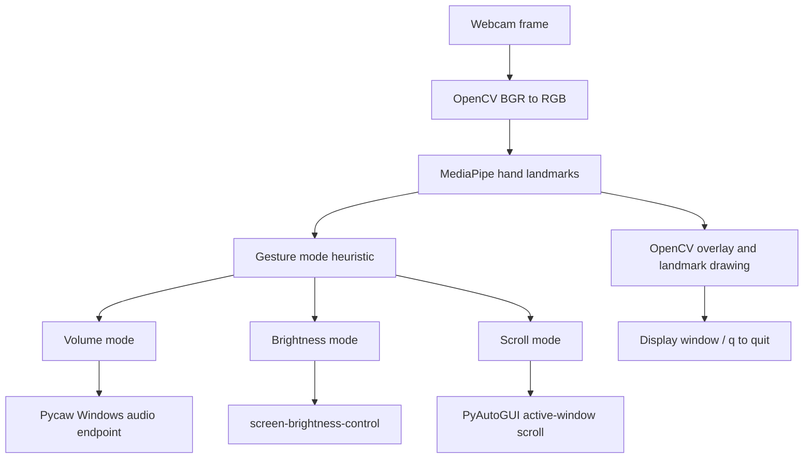

# Gesture System Control Architecture

## Overview

The prototype is a single-process Windows application with direct side effects.
It captures webcam frames, extracts hand landmarks, selects a mode from simple
heuristics, and maps landmark distances/position to desktop controls.

## Components and boundaries

- `prototype1.py` contains the original continuous-control prototype.
- An experimental `prototype2.py` exists in the local workspace but is not
  part of this public repository because its state/timing behavior is incomplete.
- MediaPipe provides normalized hand landmarks. The code uses thumb/index and
  index/middle distances plus wrist-relative positions to identify modes.
- Pycaw, screen-brightness-control, and PyAutoGUI are effectful boundaries. The
  application has no dry-run mode or safety confirmation before applying them.

## Operational and privacy notes

Frames are processed in memory by the local process; the project does not
include a network upload path or persistent recording feature. A future public
deployment would need explicit camera permission handling, an input calibration
step, configurable thresholds, fail-safe controls, and tests for each OS
adapter.
